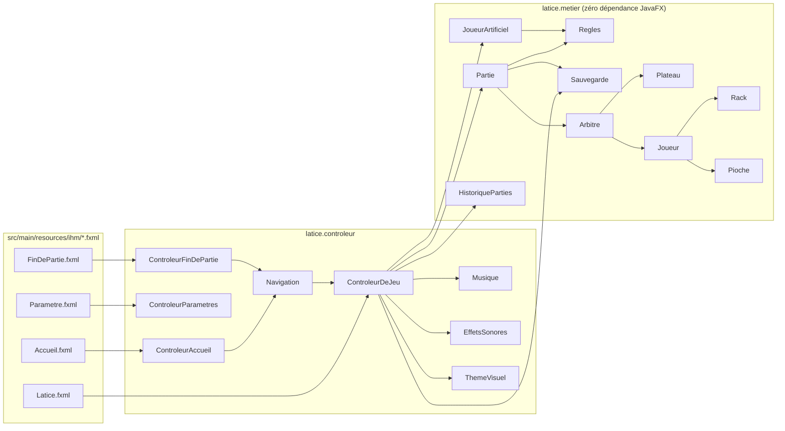
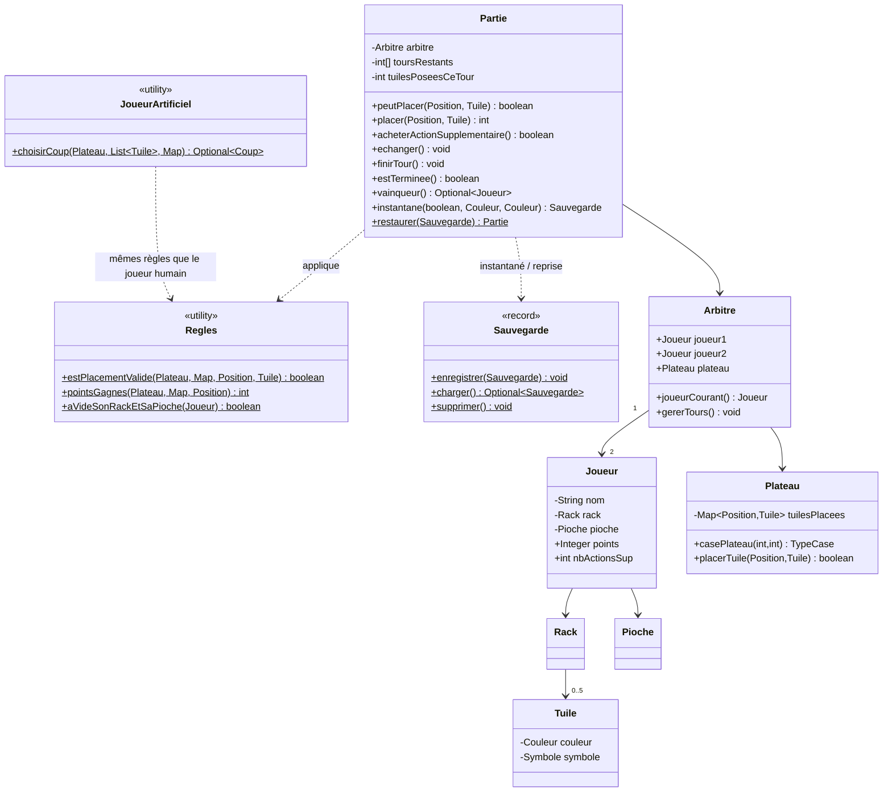
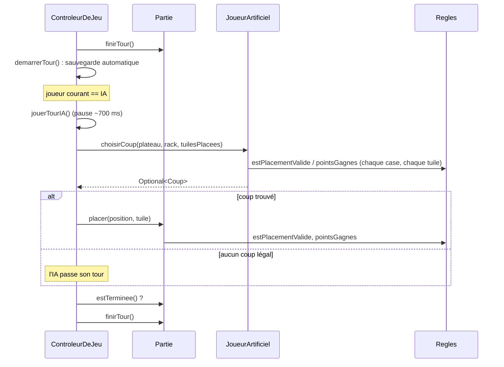

# Architecture

## Vue d'ensemble

Le code est séparé en deux packages qui ne dépendent jamais l'un de l'autre dans le mauvais sens :
`latice.metier` ne connaît rien de JavaFX (donc testable sans lancer d'interface graphique), et
`latice.controleur` affiche l'état du jeu et traduit les gestes du joueur en appels à `latice.metier`.

## Les règles : un seul endroit

`Regles` contient les règles de Latice (placement, points, fin de partie par épuisement des tuiles) et les constantes
(plateau 9×9, rack de 5, 10 tours par joueur, 2 points l'action supplémentaire). La partie graphique, l'IA et la
version console l'appellent toutes : il n'existe plus de copie à maintenir en parallèle (un défaut de règle s'était
justement retrouvé identique dans les trois copies).

Placement valide : case libre ; la toute première tuile au centre ; ensuite la tuile touche au moins une tuile posée et
est compatible (même couleur **ou** même symbole) avec **chacune** des tuiles qu'elle touche.

## Diagramme de classes (cœur du moteur de jeu)

## Séquence : tour de l'IA

Le joueur humain (glisser-déposer) et l'IA passent par la même méthode `Partie.placer(...)` : mêmes règles, mêmes
points, même pioche, sans qu'aucune des deux voies puisse diverger.

## Sauvegarde et reprise

À chaque début de tour, `Partie.instantane(...)` produit un `Sauvegarde` (joueurs, scores, racks, pioches et leur
position, plateau, joueur courant, mode solo, couleurs) écrit atomiquement dans `~/.latice/partie_en_cours.properties`.
Le menu principal affiche *Continuer* si un fichier valide existe ; `Partie.restaurer(...)` reconstruit la partie à
l'identique (les pioches reprennent exactement où elles en étaient). Le fichier est supprimé à la fin de la partie ; un
fichier absent, corrompu ou d'une autre version est simplement ignoré.

## Pourquoi ces choix

- **`latice.metier` sans JavaFX** : l'IA, les règles, la partie et la sauvegarde sont testés par de simples tests JUnit
  (parties IA contre IA complètes, allers-retours de sauvegarde), sans fenêtre ni thread FX.
- **`Partie` possède l'état, `ControleurDeJeu` l'affiche** : le contrôleur ne contient plus de règle de jeu.
- **`Navigation` comme point d'entrée unique** : ouvrir le menu, démarrer ou reprendre une partie passe toujours par la
  même classe (lancement, « Continuer », « Rejouer », « Menu principal »).
- **Données redirigeables** (`-Dlatice.donnees=...`) : les tests ne touchent jamais à `~/.latice`.
